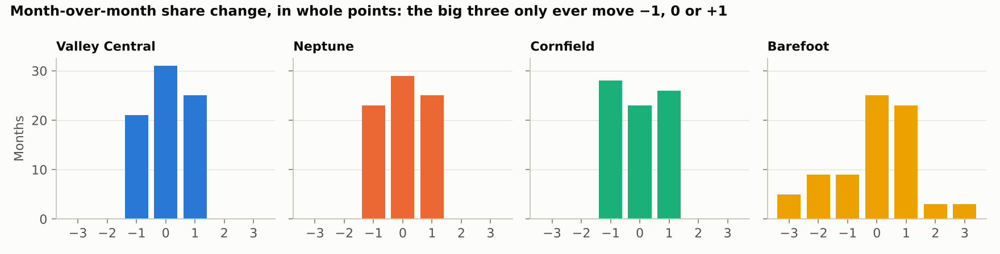
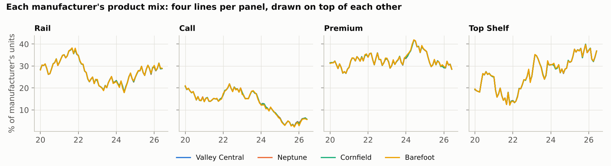
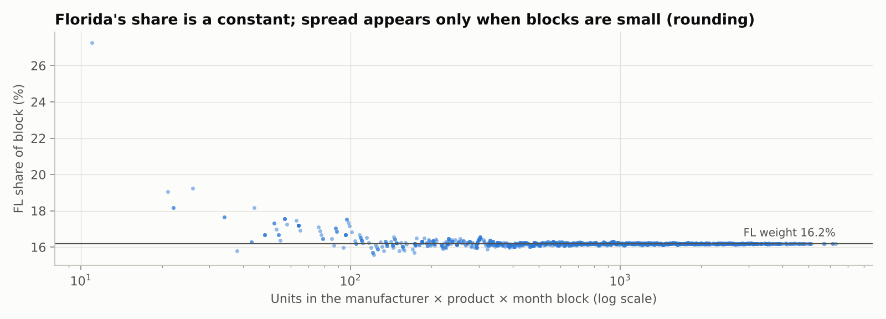
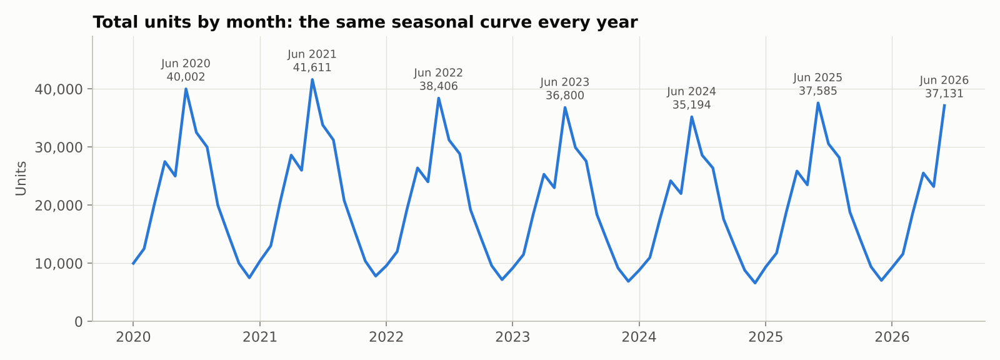
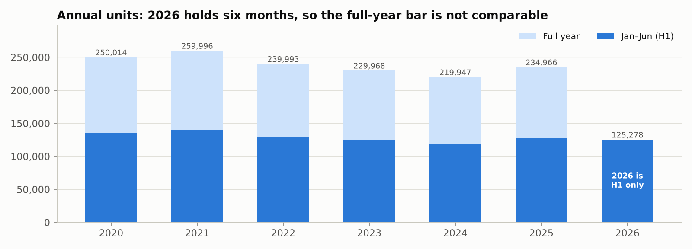
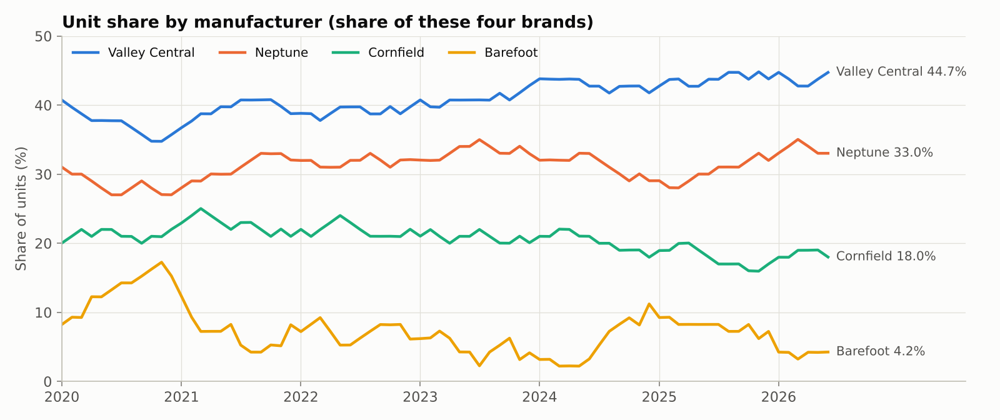
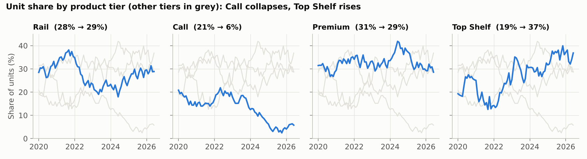

# Market Share Data (synthetic): EDA, traps, and next questions

Source file: `data/market_share_synthetic.csv` (63,648 rows; columns `Interval, Manufacturer, Product, State, Units`).
All numbers below come from `python analysis/eda.py`. The full console output is in `reports/eda_output.txt`.

## TL;DR

- **The file is clean, but it is built from a simple formula.** National total × manufacturer share × product mix × a fixed state weight, rounded to whole units. Once you see that, most of the 63k rows are redundant. Only **two series carry independent information: manufacturer share over time and product-tier mix over time.**
- **The biggest traps are time-based.** 2026 holds only six months, so a naive full-year comparison reads −46.7% when H1 vs H1 is −1.3%. June is 4× January every year, so month-over-month changes are meaningless.
- **State and cross-dimension cuts are traps.** Every brand has the same product mix, and every state gets the same fixed slice of every brand, tier and month. Any "Brand X over-indexes in Top Shelf" or "Brand X is growing in Texas" story is noise.
- **Small cells are rounding artifacts.** The data has 1,935 zeros (80% of them Barefoot). Blocks under ~100 units lose 3–17% of their volume to rounding. Cell-level growth rates of +500% or infinity are mechanical.
- **The real story:** Valley Central (+5.5 pts) and Neptune (+5.0 pts) took share from Barefoot (−7.5 pts) and Cornfield (−3.0 pts) in a market that shrank 7.2% (H1 2020 → H1 2026). Over the same period the Call tier collapsed from ~21% to ~6% of units and Top Shelf rose from ~19% to ~37%.

---

## 1. Integrity checks

| Check | Result |
|---|---|
| Rows | 63,648 = 78 months × 4 manufacturers × 4 products × 51 states. A **complete grid**, every combination present |
| Period | 2020-01 → 2026-06, no gaps |
| States | 50 states + DC (no territories) |
| Blanks / duplicate keys / negatives / non-integers | 0 / 0 / 0 / 0 |
| Zeros | 1,935 (3.0%). These are rounding outcomes, not "no data" (see trap 7) |
| Units distribution | median 10, mean 24.5, p99 197, max 1,019 (heavy right tail) |
| Row order | Sorted by Units descending within each month × manufacturer × product block. The order carries no meaning |

## 2. How the data was generated (reverse-engineered)

This is the most useful thing to say in an interview. The dataset decomposes exactly into four layers:

1. **National total = 10,000 × year factor × month factor.**
   - Month factors (Jan → Dec): `1, 1.25, 2, 2.75, 2.5, 4, 3.25, 3, 2, 1.5, 1, 0.75`. They sum to 25, so a factor-1.00 year is about 250k units.
   - Year factors: 2020 1.00, 2021 1.04, 2022 0.96, 2023 0.92, 2024 0.88, 2025 0.94, 2026 0.928.
   - The seasonal index is identical to three decimals in every year. The total has no noise at all.
2. **Manufacturer shares follow whole-point random walks.**
   - Valley Central, Neptune and Cornfield move exactly −1, 0 or +1 share point each month.
   - **Barefoot is the plug** (100 minus the others). Its monthly change correlates −0.56 to −0.62 with each of the others, while the other three are mutually uncorrelated (|r| ≤ 0.05). It is the only brand that moves ±2 or ±3 points.
3. **One product mix per month, applied to every manufacturer.**
   - Each tier's share differs across brands in the same month by a median of 0.1–0.2 pts (max 1.4 pts, in tiny cells).
   - Units(month, brand, tier) ≈ brand total × tier total ÷ market total, with a median error of 0.11%.
   - Top Shelf looks like the tier plug: it is the only tier whose monthly change correlates (−0.40 to −0.61) with the others, and it is the most volatile (σ 2.6 pts).
4. **Fixed state weights, then rounding:** cell = round(block total × state weight).
   - Across 389 large blocks, each state's share varies by only ±0.01–0.02 pts.
   - Across all 63,648 cells, the maximum gap between actual units and block × weight is **1.3 units**.





## 3. What the data actually says

### Market: shrinking slowly, highly seasonal




| | 2020 | 2021 | 2022 | 2023 | 2024 | 2025 | 2026 |
|---|---|---|---|---|---|---|---|
| Full-year units | 250,014 | 259,996 | 239,993 | 229,968 | 219,947 | 234,966 | *(H1 only)* |
| H1 units | 135,005 | 140,411 | 129,607 | 124,205 | 118,754 | 126,870 | 125,278 |
| H1 YoY | | +4.0% | −7.7% | −4.2% | −4.4% | +6.8% | **−1.3%** |

The market peaked in 2021, troughed in 2024, rebounded in 2025, and is slightly down in 2026 YTD. H1 is always 54% of the year, which implies a 2026 full year of about **232,000 units**.

### Manufacturers: consolidation toward the top two



Unit change split into a market-size effect and a share effect:

| H1 2020 → H1 2026 (market −7.2%) | Units change | Market effect | Share effect | Share pts |
|---|---:|---:|---:|---:|
| Valley Central | +3,129 | −3,725 | +6,854 | **+5.5** (38.3 → 43.8%) |
| Neptune | +3,489 | −2,784 | +6,273 | **+5.0** (28.6 → 33.6%) |
| Cornfield | −5,884 | −2,097 | −3,787 | **−3.0** (21.6 → 18.5%) |
| Barefoot | −10,461 | −1,122 | −9,339 | **−7.5** (11.5 → 4.1%) |

Last 12 months (H1 2025 → H1 2026, market −1.3%):
- **Neptune is the only brand gaining:** +5,009 units, +4.4 pts.
- Valley Central is flat in units (−74).
- Barefoot halved (−52%).

### Product tiers: Call is disappearing



| Annual unit share | 2020 | 2021 | 2022 | 2023 | 2024 | 2025 | 2026 H1 |
|---|---|---|---|---|---|---|---|
| Rail | 29.1% | 35.5% | 26.9% | 21.4% | 21.8% | 27.8% | 29.3% |
| Call | 17.3% | 14.7% | 19.7% | 16.7% | 10.5% | **4.0%** | 5.8% |
| Premium | 29.8% | 33.2% | 33.4% | 31.7% | 38.7% | 31.9% | 30.0% |
| Top Shelf | 23.8% | 16.5% | 20.1% | 30.1% | 29.1% | **36.4%** | 34.9% |

The tier names follow bar vocabulary (rail < call < premium < top shelf), which suggests price tiers. If so, the second tier is hollowing out. Top Shelf took most of that volume, and Rail recovered from its 2023–24 low (~21%) back to ~29%.

## 4. Traps and outliers

| # | Trap | Naive read | What is actually true | How to handle |
|---|---|---|---|---|
| 1 | **Partial final year** | 2026 down 46.7% | 2026 is Jan–Jun only. H1 vs H1 is −1.3% | Compare YTD with LYTD, or use rolling 12 months |
| 2 | **Seasonality** | "June +60% vs May", "December collapse", "May slump" | Fixed seasonal curve. June is 4× January. **May dips below April every year** (2.5 vs 2.75), a built-in feature, not an event | Compare with the same month last year, or seasonally adjust. Ask whether the May dip is a calendar or reporting artifact in real data |
| 3 | **Share ≠ volume** | "Valley Central is growing" | VC share +5.5 pts, but units only +6% because the market fell 7%. Last 12 months VC units are flat | Always show units, share, and the market vs share split together |
| 4 | **Small-base growth (Barefoot)** | Barefoot H1 2025 **+234%**, then H1 2026 −52% | Barefoot is the plug and absorbs the other three brands' moves. Its 8 biggest swings (±3 pts) happen exactly when all three others move together | Report changes in share points, not % growth, for small brands. Ask whether Barefoot is a real brand or "All Other" |
| 5 | **Brand × tier cuts** | "VC dominates Top Shelf" / "Cornfield is weak in Call" | Every brand has the same tier mix, so a brand's share in every tier equals its overall share | Mix and Simpson's-paradox analyses show nothing here. Value share = unit share if tier prices are common across brands |
| 6 | **State cuts** | "Florida is our growth market", "CA under-penetrated" | Every state's share is a constant, the same for every brand, tier and month. FL alone is 16.2%, more than TX+MI+MN combined (14.9%). The weights do not track population (CA 3.4%; AK 1.4% > AZ 0.7%) | No geographic insight exists in this file. Per-capita normalisation will produce artifacts. Ask for real geographic variation |
| 7 | **Rounding in small cells** | Zeros = "no sales"; summing states gives the true total | 1,935 zeros (Barefoot 1,542; Call tier 1,190; mostly NM, DC, WY, VT, NV). Blocks under 100 units lose 3–17% on average to rounding. Worst: Barefoot × Call, Jan 2026, sums to 11 where ~16 is implied (−31%) | Suppress or aggregate cells below a volume threshold. Don't take logs or % changes on cells with 0 or 1 unit |
| 8 | **Cell-level growth rankings** | "Barefoot Rail in AZ/ID/ND grew 500%" | 1 → 6 units. In Jun-25 vs Jun-24, 11 cells have infinite growth and 5 have 0/0. The top 10 growth cells are all Barefoot | Rank by absolute change, or use shrinkage or minimum-volume rules |
| 9 | **Raw-value "outliers"** | IQR rule flags 5,594 cells (8.8%); max 1,019 = VC × Premium × FL × Jun-2024 | All structural: big brand × FL × June. 64% of flagged cells are in the top-8 states | Detect outliers on normalised series (share, index vs expected), not raw units. In this file the genuine anomalies are the Barefoot ±3-pt months (Apr-20, Jan-21, Feb-21, Jul-21, Dec-21, Nov-23, Dec-24, Jan-26) |
| 10 | **Realism gaps** | Treat as a real market | No COVID shock in Mar–Apr 2020 (index exactly 1.00). No noise in the total. "Market" means these four brands only | State the assumptions explicitly. Share is share of a 4-brand universe, not the true market |
| 11 | **Undefined measures** | Units = sales | Units could be shipments, retail sales, or registrations. Tier order is inferred from the names | Ask (see below) |

## 5. Directions for further inquiry

**Questions to ask the data owner**
1. What is a "unit": shipment, retail sale, or registration? Is there a reporting lag, and do recent months get revised upward?
2. Is this the whole market, or four tracked brands? Is Barefoot a real competitor or an "All Other" bucket?
3. Are the four products price tiers, and do prices differ by brand? That decides whether dollar share would differ from unit share.
4. Is the state split real in the production data? If yes, what is the right baseline: population, dealer count, or the category's installed base?
5. Domain hunch, offered as a guess only: the state ranking (FL far ahead, then TX, MI, MN, NC, WI), the June peak, and roughly 250k units a year look a lot like US recreational-boat retail registration data. If that is the domain, registration lag and state reporting gaps are the first data-quality issues to ask about.

**Analyses worth building next**
1. **Share-shift monitor:** monthly decomposition of each brand's unit change into market effect + share effect (started in `reports/tables/h1_change_decomposition.csv`). Report rolling-12-month and YTD vs LYTD views, never raw month-over-month.
2. **Source of share:** who gains from whom. In this synthetic file the answer is "everyone from Barefoot", because it is the plug. In real data, a switching or correlation matrix of monthly share changes is a cheap first pass.
3. **Tier migration:** is Call volume trading up to Top Shelf or down to Rail? In this file Top Shelf's monthly changes mirror Rail's (r = −0.61) and Premium's (−0.57) more than Call's (−0.40). Call's decline is a slow drift, not a step change, so ask whether a tier was redefined.
4. **Forecasting:** the total is a deterministic seasonal curve times an annual level (2026 FY ≈ 232k). Share changes show no momentum (lag-1 autocorrelation of monthly changes is −0.06 to 0.18, none significant over 77 months), so a last-value forecast for share is the honest baseline. Any trend model should beat it in a backtest before anyone trusts it.
5. **Geographic white space (real data only):** state share vs the national share (location quotient), and penetration vs a population or installed-base denominator.
6. **Automated data-quality guards** for a production pipeline:
   - grid completeness;
   - totals reconcile across levels;
   - small-cell suppression;
   - zero vs missing;
   - partial-period flag on the latest year;
   - alerts when a share moves more than N points in a month.
7. **Dashboard design:** KPI tiles for YTD units, YoY %, share, and share change in points. Show rolling-12 trend lines for share and tier mix, a seasonality-aware month-vs-same-month-last-year chart, and suppression notes on any cut below the volume threshold.

## 6. Follow-up analysis: answers from the data

`analysis/further_analysis.py` and `analysis/dq_checks.py` answer the analysis questions in section 5 that the file itself can answer. Their output is in `reports/further_analysis_output.txt` and `reports/dq_checks_output.txt`.

### Share-shift monitor (rolling 12 months to Jun 2026 vs the 12 before; market +2.3%)

| Brand | Units (R12) | Change | Market effect | Share effect | Share | Share change |
|---|---:|---:|---:|---:|---:|---:|
| Valley Central | 102,681 | +4,854 | +2,278 | +2,576 | 44.0% | +1.1 pts |
| Neptune | 76,060 | +7,922 | +1,587 | +6,335 | 32.6% | **+2.7 pts** |
| Cornfield | 41,349 | −2,528 | +1,022 | −3,550 | 17.7% | −1.5 pts |
| Barefoot | 13,284 | −4,937 | +424 | −5,361 | 5.7% | −2.3 pts |

- Neptune has the momentum: 80% of its gain is share, not market growth.
- Cornfield and Barefoot lost share even though the market grew.
- The monthly series is in `reports/tables/r12_share_shift_monitor.csv`.

### Who took share from whom

Method: each month, every brand's share gain is allocated to the losing brands in proportion to their losses (`reports/tables/brand_share_flows.csv`).
- **The brands churn a lot but net out small.** Gross movement adds up to ~126 share points over 77 months. The largest net transfer between any pair is 4.3 points.
- **70% of all movement involves Barefoot.** Net over Jan 2020 – Jun 2026:
  - Valley Central took 4.3 pts from Barefoot.
  - Neptune took 4.3 pts from Cornfield but lost 3.2 pts to Barefoot.
  - Cornfield took 2.9 pts from Barefoot.
- **Caveat:** the three big brands move independently and Barefoot is the plug, so these flows describe how the data was generated, not customers switching. With real data, use switching or trade-in data to answer this properly.

### Tier migration

- Since Call's peak (May 2022, 21.9%), Call lost 16.1 points and Top Shelf gained 17.0. Rail moved +1.1 and Premium −2.0.
- Allocating monthly moves, Call's net losses went 7.1 pts to Top Shelf, 5.2 to Premium and 3.8 to Rail. Over the full period Premium in turn lost a net 9.7 pts to Top Shelf.
- **The mix traded up.** Top Shelf behaves as the tier plug, so the same generator caveat applies (`reports/tables/tier_share_flows.csv`).

### Forecasting: what works, and the 2026 outlook

- **Market total:** the seasonal curve forecasts Jul–Dec from Jan–Jun with **0.03–0.09% error** (MAPE, 2021–2025 backtests). "Same month last year" misses by 3.8–8.4%.
- **Brand share:** in a rolling backtest from 2022, carrying the last value forward beats a 12-month linear trend at every horizon. It only ties the 12-month average at one year:

| Horizon | Last value | 12-month average | 12-month linear trend |
|---|---:|---:|---:|
| 1 month | **0.72 pts** | 1.28 | 0.80 |
| 3 months | **1.21** | 1.50 | 1.40 |
| 6 months | **1.58** | 1.80 | 2.02 |
| 12 months | 2.22 | **2.17** | 3.35 |

  Don't extrapolate share trends here: monthly share changes have no momentum.

- **2026 forecast:** full year **≈ 231,992 units, −1.3% vs 2025** (H1 actual 125,278 + H2 forecast 106,714). Jul–Dec by month: 30,167 · 27,839 · 18,557 · 13,920 · 9,276 · 6,956.
- Brand Jul–Dec units at June shares, with an 80% band for the December share from past six-month moves:
  - Valley Central 47,731 (44.7%, band 42.7–47.8%)
  - Neptune 35,238 (33.0%, 31.0–36.0%)
  - Cornfield 19,210 (18.0%, 15.0–20.0%)
  - Barefoot 4,535 (4.2%, 0.2–9.2%)

  The full table is in `reports/tables/forecast_h2_2026.csv`.

### Data-quality guards

`analysis/dq_checks.py` runs 12 checks and exits non-zero on any failure, so it can gate a pipeline. On this file: **7 pass, 5 warn, 0 fail**. The warnings are:
- partial latest year;
- 1,935 zero cells;
- 14 brand × tier × month blocks under 50 units;
- 11 monthly share moves of 2+ points (all Barefoot);
- state shares that never move.

### What still needs the data owner

These can't be answered from the file:
- what a unit is;
- whether Barefoot is a real brand;
- whether tiers are price bands;
- whether real geography varies.

## 7. Dashboards

- **HTML:** `dashboard/index.html` is one file with the data embedded. Open it in a browser; the charts load Chart.js from jsDelivr, so they need a connection.
  - Filters: period, brands, tiers, states/regions, time grain, and a minimum-volume threshold for growth rates.
  - Contents: KPI tiles, a share ladder, brand and tier trends, a market vs share split, seasonality, the 2026 forecast, and sortable brand × tier and state tables with copy-to-CSV.
  - A warnings row flags the traps that apply to the current selection.
  - Rebuild it with `python analysis/build_dashboard.py`.
- **Tableau Public:** `tableau/market_share_tableau.csv` (the data plus helper columns, including units a year earlier) and `tableau/BUILD_GUIDE.md` (calculated fields, sheets, layout, and the numbers to check against).

## 8. Reproduce

```bash
pip install pandas numpy matplotlib
python analysis/eda.py                # EDA figures and tables
python analysis/further_analysis.py   # share-shift monitor, flows, backtests, 2026 forecast
python analysis/dq_checks.py          # data-quality guards (non-zero exit on failure)
python analysis/build_dashboard.py    # dashboard/index.html and tableau/market_share_tableau.csv
```

| Output | Contents |
|---|---|
| `reports/tables/annual_vs_h1.csv` | Full-year vs H1 totals and the naive vs correct YoY |
| `reports/tables/manufacturer_share_monthly.csv` | Monthly share by brand |
| `reports/tables/manufacturer_annual_h1.csv` | Annual and H1 units by brand |
| `reports/tables/h1_change_decomposition.csv` | Market vs share effect |
| `reports/tables/product_share_monthly.csv` | Monthly tier mix |
| `reports/tables/state_weights.csv` | Fixed state allocation |
| `reports/tables/block_rounding.csv` | Observed vs implied block totals (rounding loss) |
| `reports/tables/r12_share_shift_monitor.csv` | Rolling-12 market vs share effect by brand, every month |
| `reports/tables/brand_share_flows.csv`, `tier_share_flows.csv` | Gross share flows between brands and between tiers |
| `reports/tables/backtest_market.csv`, `backtest_share.csv` | Forecast backtest errors |
| `reports/tables/forecast_h2_2026.csv` | Jul–Dec 2026 forecast by brand with 80% share bands |
